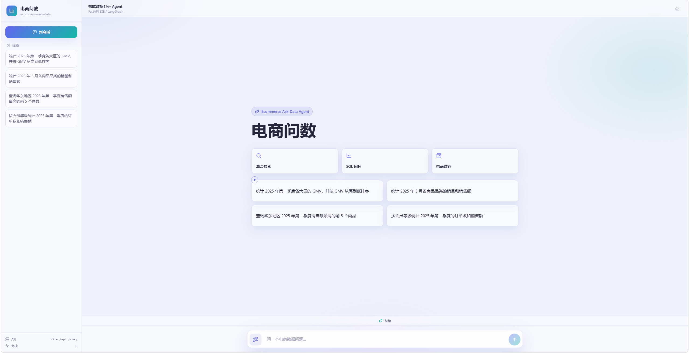
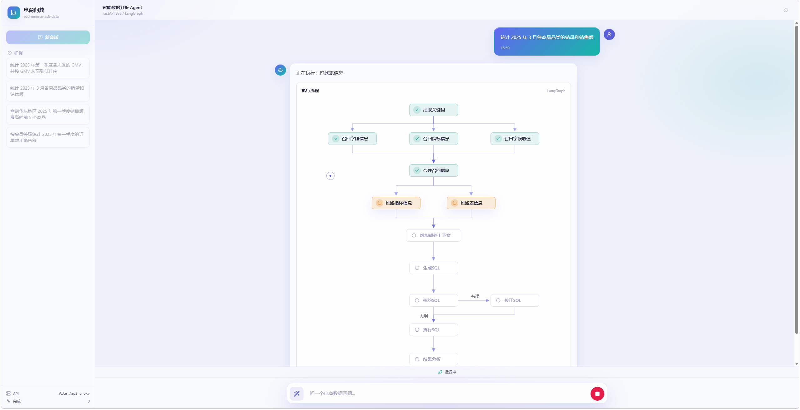
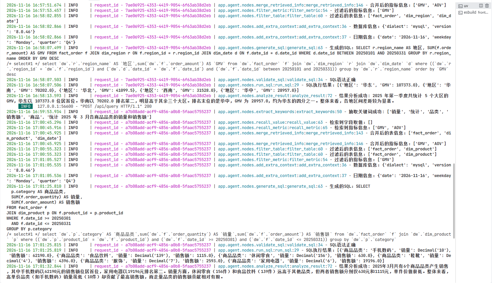
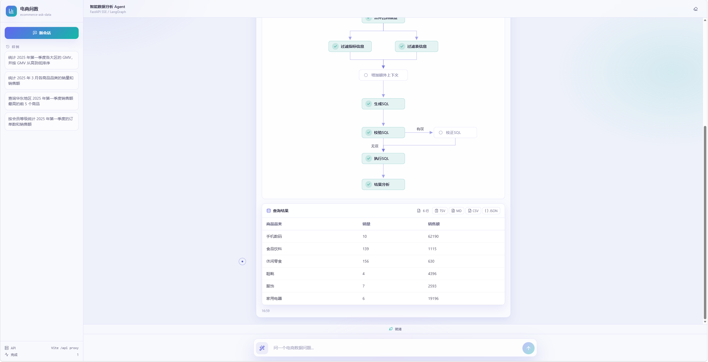
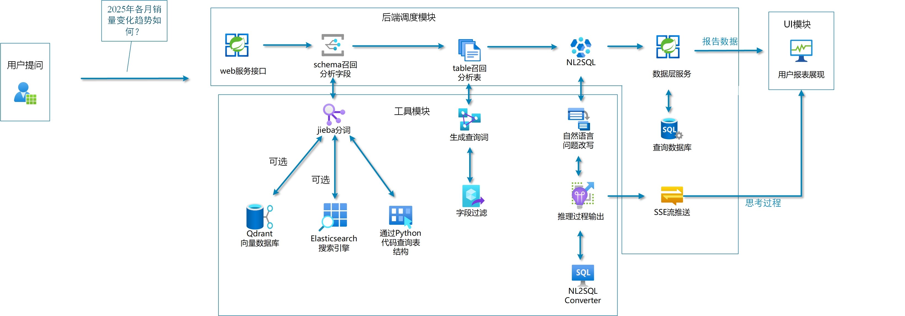

<div align='center'>
  <h1 style="margin-top: 15px;">「电商问数」智能数据分析 Agent</h1>
  <h4><b>ecommerce-ask-data</b></h4>
  <p><em>面向电商数仓场景的端到端 Text2SQL 智能体：混合检索 + LangGraph 多阶段推理 + SQL 生成/校验/修正/执行 + SSE 流式交付</em></p>
</div>

<div align='center'>


</div>



## 项目概述

这是我独立开发并完整落地的一个 **Text2SQL 智能问数项目**。它解决的问题很实际：业务同学不会写 SQL，分析师又记不住所有表结构、字段含义、指标口径和字段取值。把自然语言直接丢给大模型，很容易出现选错表、选错字段、指标理解偏差和 SQL 幻觉。

我的做法不是让模型"一步直出 SQL"，而是搭建了一条完整的工程链路：

1. **元数据知识库**：对电商数仓做表/字段/指标/取值四层元数据建模，同步写入结构化库、向量库和全文索引。
2. **混合检索**：围绕用户问题，字段、指标、取值三路并行召回，再合并、重排与过滤，为模型提供准确上下文。
3. **LangGraph 工作流**：用 13 个节点的状态机编排关键词抽取、召回、SQL 生成、EXPLAIN 校验、错误修正、执行与结果分析的全流程。
4. **服务与前端**：FastAPI 以 SSE 流式协议实时推送每个节点的执行进度与结果，React 前端做流程可视化、打字机渲染和结果一键导出。

> 项目的初始架构设计参考了开源教程体系 [ai-agents-from-zero](https://github.com/didilili/ai-agents-from-zero)（MIT 协议）。在吃透原设计的基础上，本项目由我独立完成结果分析节点、查询结果导出（TSV/Markdown/CSV/JSON）、前端玻璃拟态改版与微交互套件，以及全链路前后端联调与稳定性修复。

## 核心亮点

### 1. LangGraph 13 节点问数工作流

不是简单的 Prompt 串联，而是一个带条件分支的有状态图：

- 抽取关键词后，**字段 / 指标 / 取值三路并行召回**，再合并过滤；
- SQL 生成后先走 **EXPLAIN 干跑校验**，无效 SQL 进入修正节点重试，而不是直接执行报错；
- 校验通过后执行 SQL，最后由 LLM 基于查询结果自动生成数据解读文案。



### 2. 面向企业元数据的混合检索架构

单一向量检索对"字段取值"这类精确匹配召回效果差，我按信息类型拆分了三条检索通道：

| 通道 | 存储 | 职责 |
| ---- | ---- | ---- |
| 语义召回 | `Qdrant` + `bge-large-zh-v1.5` | 字段、指标的语义匹配 |
| 全文召回 | `Elasticsearch`（IK 分词） | 字段真实取值的关键词检索 |
| 权威元数据 | `MySQL` | 完整的表/字段/指标结构化信息，召回后过滤校验 |

### 3. SSE 流式事件协议

后端把 Agent 的每一步推理过程实时推给前端，四种事件类型覆盖全生命周期：

| 类型 | 含义 |
| ---- | ---- |
| `progress` | 节点执行进度 |
| `result` | 最终查询结果 |
| `analysis` | LLM 结果分析文案 |
| `error` | 全局异常消息 |

前端据此渲染节点状态流转，用户能直观看到 Agent"想到了哪一步"。

### 4. 全链路请求追踪

基于 `ContextVar` + `loguru` 为每个并发请求注入 `request_id`，所有节点日志自动携带链路标识，多请求并发时可精确聚合单次问数的完整执行过程，大幅降低排障成本。



### 5. 结果分析与一键导出

- SQL 执行完成后，LLM 自动生成三五句话的数据解读，指出趋势、异常与关注点；
- 查询结果支持一键复制 TSV/Markdown、下载 CSV（含 BOM，Excel 打开中文不乱码）与 JSON。



### 6. 工程化后端结构

`FastAPI + LangGraph + Repository + Client Manager` 分层组织：配置加载、客户端生命周期、仓储层、服务层与智能体节点职责清晰，新增一路召回或一个节点不需要动整体框架。

### 7. 自研前端

React 19 + Vite + Tailwind CSS 玻璃拟态 UI，包含 LangGraph 全流程可视化、SSE 流式渲染、打字机效果、入场渐次浮现、行高亮与微交互套件，无第三方重型组件库依赖。

## 系统架构



项目围绕两条主线展开：

| 主线 | 做什么 | 涉及模块 |
| ---- | ------ | -------- |
| 元数据知识库构建 | 抽取电商数仓中的表、字段、指标和字段取值，写入结构化库、向量库和全文索引 | `MySQL` / `Qdrant` / `Elasticsearch` / `TEI` |
| 自然语言问数 | 基于用户问题完成召回、上下文整理、SQL 生成校验执行，并把过程流式返回前端 | `LangGraph` / `FastAPI` / `SSE` / `React` |

## 技术栈

| 模块 | 技术 | 作用 |
| ---- | ---- | ---- |
| 示例数仓 | `MySQL` | 事实表、维度表和分析型查询环境 |
| 元数据库 | `MySQL` / `SQLAlchemy` | 保存表、字段、指标、字段指标关系等结构化元数据 |
| 向量检索 | `Qdrant` | 字段和指标向量存储，语义召回 |
| 全文检索 | `Elasticsearch`（IK） | 字段真实取值存储，关键词检索 |
| Embedding | `TEI` / `BAAI/bge-large-zh-v1.5` | 字段、指标、问题的向量化 |
| 智能体编排 | `LangGraph` | 13 节点多阶段问数工作流 |
| 模型接入 | `LangChain` | 封装 LLM 与 Embedding 调用 |
| 后端接口 | `FastAPI` | 问数 API、依赖注入、生命周期管理 |
| 流式协议 | `SSE` | 实时推送节点进度、结果与错误 |
| 前端 | `React 19` / `Vite` / `Tailwind CSS` | 聊天式问数界面与流程可视化 |
| 日志追踪 | `ContextVar` / `loguru` | request_id 全链路日志 |
| 依赖管理 | `uv` / `pnpm` | Python 后端与前端依赖管理 |

## 项目结构

```text
ecommerce-ask-data/
├── app/
│   ├── agent/            # LangGraph 图、状态、上下文和各类节点
│   ├── api/              # FastAPI 路由、依赖注入、生命周期和请求结构
│   ├── clients/          # MySQL、Qdrant、Elasticsearch、Embedding 客户端管理
│   ├── conf/             # 配置 dataclass 与配置加载工具
│   ├── core/             # 日志、request_id 上下文等通用能力
│   ├── entities/         # 更贴近业务语义的数据对象
│   ├── models/           # SQLAlchemy ORM 模型
│   ├── prompt/           # Prompt 加载工具
│   ├── repositories/     # MySQL、Qdrant、Elasticsearch 数据访问层
│   ├── scripts/          # 元数据知识库构建脚本
│   └── services/         # 元数据构建服务和问数查询服务
├── conf/                 # app_config.yaml、meta_config.yaml
├── docker/               # Docker Compose、MySQL 初始化 SQL、ES 插件、Embedding 挂载目录
├── frontend/             # React + Vite + Tailwind CSS 前端项目
├── prompts/              # SQL 生成、修正、过滤等 Prompt 模板
├── main.py               # FastAPI 应用入口
└── pyproject.toml        # Python 项目依赖与工具配置
```

## 快速开始

### 1. 准备环境

- Python `>= 3.14`
- `uv`
- Docker 与 Docker Compose
- Node.js 与 `pnpm`

### 2. 克隆项目

```bash
git clone https://github.com/yangdemao/ecommerce-ask-data.git
cd ecommerce-ask-data
```

### 3. 安装后端依赖

```bash
uv sync
```

### 4. 配置大模型 API Key

```bash
cp .env.example .env
```

把 `.env` 中的 `LLM_API_KEY` 替换成真实密钥：

```bash
LLM_API_KEY=your_real_api_key
```

默认配置使用兼容 OpenAI 接口的硅基流动服务：

```yaml
llm:
    model_name: Pro/zai-org/GLM-5.1
    api_key: ${oc.env:LLM_API_KEY}
    base_url: https://api.siliconflow.cn/v1
```

如需使用其他兼容 OpenAI API 的模型平台，修改 [conf/app_config.yaml](conf/app_config.yaml) 中的 `model_name` 和 `base_url`。

### 5. 准备 Embedding 模型

项目通过 `TEI` 加载 `BAAI/bge-large-zh-v1.5`。模型文件体积较大，无法在仓库中提交，需要先下载到 Docker 挂载目录：

```bash
uv run hf download BAAI/bge-large-zh-v1.5 --local-dir docker/embedding/bge-large-zh-v1.5
```

如果手动下载，请解压到：`docker/embedding/bge-large-zh-v1.5` 路径下。

### 6. 启动 Docker 基础服务

```bash
docker compose -f docker/docker-compose.yaml up -d
```

默认端口：

| 服务 | 端口 |
| ---- | ---- |
| MySQL | `3306` |
| Elasticsearch | `9200` |
| Kibana | `5601` |
| Qdrant | `6333` |
| Embedding | `8081` |

> `docker/mysql/meta.sql` 和 `docker/mysql/dw.sql` 会在 MySQL 容器首次启动时自动初始化元数据库和示例数仓。

> Embedding 服务（TEI，CPU 模式）加载模型约需 1-2 分钟，就绪前发起查询会导致召回节点报 `Server disconnected`。启动后建议先确认：`curl http://localhost:8081/health` 返回 200 再使用。

### 7. 构建元数据知识库

```bash
uv run python -m app.scripts.build_meta_knowledge -c conf/meta_config.yaml
```

这一步会把表字段元数据写入 MySQL，把字段和指标向量写入 Qdrant，并把字段真实取值写入 Elasticsearch。

### 8. 启动后端

```bash
uv run fastapi dev main.py
```

后端接口：

```text
POST http://127.0.0.1:8000/api/query
```

请求示例：

```json
{
    "query": "统计华北地区的销售总额"
}
```

### 9. 启动前端

```bash
cd frontend
pnpm install
pnpm dev
```

前端默认通过 Vite 代理把 `/api` 转发到 `http://127.0.0.1:8000`。如需修改：

```bash
cd frontend
cp .env.example .env
```

```bash
VITE_DEV_PROXY_TARGET=http://127.0.0.1:8000
```

## 开发里程碑

| 阶段 | 内容 |
| ---- | ---- |
| 基础设施 | uv 依赖管理、OmegaConf 分层配置、loguru 结构化日志、Docker Compose 编排 MySQL/Qdrant/ES/TEI |
| 元数据知识库 | 表/字段/指标元数据入库，字段向量索引、字段取值全文索引、指标向量索引三线构建 |
| 混合检索 | LLM 关键词抽取，字段/指标/取值三路并行召回，合并、重排与过滤 |
| 智能体工作流 | LangGraph 13 节点：上下文构建 → SQL 生成 → EXPLAIN 校验 → 错误修正 → 执行 → 结果分析 |
| 服务层 | FastAPI `/api/query` SSE 流式接口、QueryService 依赖组装、request_id 全链路日志 |
| 前端与交付 | React 玻璃拟态 UI、流程可视化、流式渲染与微交互、结果一键导出（TSV/MD/CSV/JSON） |

## 能力边界与后续规划

当前版本聚焦把智能问数最关键、最必要的工程链路完整落地并稳定跑通。以下是我明确知道还没做、但已经规划好的方向：

- SQL 安全审计与执行白名单、查询缓存与限流
- 多轮问数的会话记忆与追问改写
- 系统化评测集与自动化回归评测
- 用户权限与多租户隔离
- 监控告警与灰度发布

这些扩展点也正是这个项目接下来值得继续深挖的地方。
